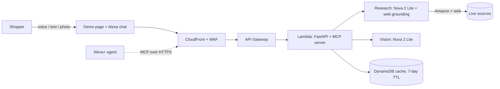

# ReturnKiller

**Ask Alexa before you buy. Skip the return.**

ReturnKiller tells a shopper whether an Amazon product will fit their space and match its listing
*before* they order, so they don't have to send it back. It looks the product up live on Amazon
and the web, checks the fit with real arithmetic, scores the return risk, and gives sellers the
listing changes that would prevent the return. The main interface is a conversation with Alexa.

Built solo for the **Amazon Developer Hackathon: "Build, Ship, Shape" (Alexa+ track)**.

- Live demo: https://d1lvpvq4ziigp8.cloudfront.net/demo
- The Alexa+ in the demo is **simulated**. The chat page talks to the same MCP server a real
  Alexa+ agent would use, so no Echo device is needed to try it. See [Honest limits](#honest-limits).

---

## Table of contents
1. [The problem](#the-problem)
2. [What it does](#what-it-does)
3. [How it works](#how-it-works)
4. [AWS services and integrations](#aws-services-and-integrations)
5. [Alexa and MCP](#alexa-and-mcp)
6. [API reference](#api-reference)
7. [Project layout](#project-layout)
8. [Deploy your own](#deploy-your-own)
9. [Configuration](#configuration)
10. [Run tests and run locally](#run-tests-and-run-locally)
11. [Security and cost controls](#security-and-cost-controls)
12. [Honest limits](#honest-limits)
13. [Roadmap](#roadmap)

---

## The problem
Online shopping is one of the largest industries in the world, and shoppers want convenience.
But a lot of that convenience ends in a return: the shelves that don't fit the alcove, the air fryer
that doesn't fit under the cabinet, the item that isn't what the photos suggested. Returns cost
shoppers time, sellers margin and Amazon shipping and handling.

The information needed to avoid most of these returns already exists (listed dimensions, what
other buyers report), but it is scattered across the listing, reviews and questions, and nobody
does the arithmetic against their own space.

## What it does
| Feature | Description |
|---|---|
| **Ask Alexa chat** | Type or speak. Name a product and your space: "Will a Ninja air fryer fit under my 40 cm cabinet?", "How risky is it?". It answers only what was asked. |
| **Live Amazon and web research** | Every product is researched at the time you ask. There is no fixed catalog. Sources are shown as links. |
| **Fit check done in code** | The model finds the facts; plain arithmetic compares the product height with your clearance and says *fits*, *tight* or *too tall by N cm*. |
| **Return-risk score** | A 0 to 100 score with the top size, fit and "not as described" complaints buyers report, and the listing changes that would prevent them. |
| **Scan my space / Upload photo** | A vision model estimates clearance height from a photo of your cabinet or shelf, then uses it for the fit check. |
| **Search bar and Analyze** | Look a product up yourself, then press Analyze for the full breakdown and sources. |
| **Ask Alexa button** | Opens a dialog showing how Alexa connects, including the MCP endpoint. |
| **Voice in and out** | Browser speech recognition for questions, speech synthesis for answers. |

## How it works



**One question, step by step**
1. The chat's intent router decides what was asked: a product lookup, a fit question or a risk question. Off-topic questions get a short scope reply instead of an invented answer.
2. For a product it has not seen, the server asks Nova 2 Lite with web grounding to search Amazon first, then reputable sites, and return a strict JSON object: title, category, price, dimensions, common complaints, listing tips, plus the cited source URLs.
3. The result is validated in code (see below) and cached in DynamoDB for 7 days.
4. For a fit question, if no height was found the first time, one focused second lookup searches only for the exact dimensions. Then `fit_check` compares height with the clearance you gave or the one estimated from your photo.
5. For a risk question, the score and complaints come from the analysis (below).

**Design rule: the model writes words, code decides facts.**
- *Fit* is arithmetic: margin of 3 cm or more = likely fits, 0 to 3 cm = tight, below 0 = too tall.
- *Risk score* for researched products = `min(20 + complaint weights (high 15, medium 8, low 3) + 5 if dimensions are missing, 80)`. The basis is labelled `web_research`, and is never presented as measured store return data.
- If a dimension is unknown, the app says it cannot check the fit and does not guess.
- The model must name the product you asked about. A result whose title does not match your query is rejected rather than substituted.

**Web text is untrusted.** Everything read from the web is validated (field types, ranges, lengths), only `http`/`https` source links are kept, and all text is escaped when rendered, so a hostile page cannot inject instructions or markup.

## AWS services and integrations
| Service | Where in the repo | What it does |
|---|---|---|
| **Amazon Bedrock: Nova 2 Lite** (`us.amazon.nova-2-lite-v1:0`) | `analyzer.py`, `research.py` | Converse API for analysis, listing fixes, spoken answers and structured research output |
| **Nova web grounding** (`nova_grounding` system tool) | `research.py` | Live Amazon and web search with citations; second pass for exact dimensions |
| **Bedrock vision** | `analyzer.py` (`scan_space`) | Estimates clearance height from a photo of the space |
| **AWS Lambda** (arm64 container image + Lambda Web Adapter) | `Dockerfile`, `infra/main.tf` | Runs the FastAPI app and the MCP server unchanged |
| **Amazon API Gateway** (HTTP API) | `infra/main.tf` | Public entry to the Lambda, with throttling |
| **Amazon CloudFront + AWS WAF** | `infra/main.tf` | HTTPS front door, per-IP rate limits (tight on `/scan`), origin-verify secret so the API URL cannot be hit directly |
| **Amazon DynamoDB** | `app.py` (`AnalysisCache`) | 7-day TTL cache of researched products and analyses |
| **Amazon ECR** | `deploy.sh`, `infra/main.tf` | Container registry for the image |
| **IAM, CloudWatch Logs, AWS Budgets** | `infra/main.tf`, `iam-bedrock-policy.json` | Least-privilege Bedrock access (including `bedrock:InvokeTool` for grounding), logging, monthly cost alert |

Everything is Terraform in `infra/`. Scan photos are processed in memory and are not stored.

Notes on the Bedrock integration:
- Bedrock calls use the **US cross-region inference profile**; the bare model ID is not callable on demand.
- Web grounding is available in US regions only and needs the `bedrock:InvokeTool` permission on `arn:aws:bedrock::*:system-tool/amazon.nova_grounding`. It has extra cost and returns citations that the UI displays.
- Throttling is reported honestly: if the account's token quota is exhausted, the app says live search is out of quota instead of guessing.

## Alexa and MCP
ReturnKiller exposes its logic as a **Model Context Protocol** server (stateless Streamable HTTP, JSON responses) at `/mcp`, mounted in the same FastAPI app.

| Tool | Purpose |
|---|---|
| `research_product(query)` | Look up a product on Amazon and the web; returns the product, an id, and a spoken sentence |
| `check_fit(asin, space_description)` | Fit verdict computed from the listed height and the space the shopper described |
| `analyze_listing(asin)` | Return-risk score, top complaints with sources, listing fixes, and a spoken summary |

Every tool returns a `spoken` field written for text-to-speech.

The demo page's Alexa chat (`static/alexa.html`) is a small MCP client plus an intent router standing in for Alexa+. It speaks to `/mcp` exactly as an agent would. Add `?debug=1` to `/alexa` to see the raw tool calls.

## API reference
| Method and path | Purpose |
|---|---|
| `GET /` | Name, version, build SHA, endpoint list |
| `GET /health` | Liveness. `?deep=true` makes real Bedrock and web-grounding calls and shows the exact AWS error if one fails |
| `GET /research?q=` | Live web research for a product (429 when throttled, 503 when Bedrock is off) |
| `GET /analyze/{asin}` | Full analysis, including complaints, sources and sample reviews |
| `POST /analyze` | Analyze a product object |
| `POST /fit` | Fit question: `{asin, question, space_description}` |
| `POST /scan` | Multipart photo upload (`file`, optional `asin`, `hint`); max 4 MB |
| `GET /demo` | The demo page |
| `GET /alexa` | The Alexa chat page (embedded in the demo) |
| `POST /mcp` | MCP endpoint |

Product ids from web research look like `web-<slug>`; they are re-researched from the slug if they are no longer cached.

## Project layout
```
app.py              FastAPI app, endpoints, DynamoDB cache, the demo page HTML
analyzer.py         Nova calls, risk scoring, fit_check, photo scan
research.py         Live web research, validation, throttle handling, dimension lookup
mcp_server.py       The three MCP tools
catalog.py          Optional local catalog loader (empty by default)
static/alexa.html   The Alexa chat: MCP client, intent router, voice, photo upload
scripts/            Optional data tooling (web-research seeding, review ingestion)
tests/              Unit and API tests
infra/              Terraform (Lambda, API Gateway, CloudFront, WAF, DynamoDB, S3, ECR, Budgets)
Dockerfile          arm64 Lambda image using the Lambda Web Adapter
deploy.sh           Two-phase deploy: ECR, build and push image, apply the rest
```

## Deploy your own
Prerequisites: an AWS account with Amazon Nova 2 Lite enabled in `us-east-1`, Terraform 1.6 or newer, Docker with buildx, and the AWS CLI v2 logged in.

```bash
cd infra
cp terraform.tfvars.example terraform.tfvars   # set budget_email
cd ..
./deploy.sh
```

`deploy.sh` creates the ECR repository, builds and pushes the image (tagged with the git SHA), then applies the rest and prints the URLs. Then check:

```bash
curl https://<app_url>/health                  # liveness
curl "https://<app_url>/health?deep=true"      # real Bedrock + web grounding calls
open https://<app_url>/demo
```

Request a Bedrock quota increase early (Service Quotas, Amazon Bedrock, Nova 2 Lite). New accounts can hit the daily token limit during testing. See `infra/README.md` for more.

## Configuration
| Variable | Default | Meaning |
|---|---|---|
| `RETURNKILLER_USE_BEDROCK` | `1` in the image | Turns Bedrock analysis, research and vision on |
| `RETURNKILLER_MODEL_ID` | Nova 2 Lite `us.` profile | Override the model |
| `CACHE_TABLE` | set by Terraform | DynamoDB table for the cache (in-memory if unset) |
| `ORIGIN_VERIFY` | set by Terraform | Secret header CloudFront sends; requests without it are rejected |
| `CORS_ORIGINS` | `*` | Allowed origins |
| `RETURNKILLER_CATALOG` | unset | Optional path to a local products JSON file |
| `BUILD_SHA` | set at build | Shown at `/` so you can confirm what is deployed |

Terraform variables (`infra/variables.tf`): `region`, `lambda_memory_mb` (1024), `lambda_timeout_s` (30; API Gateway cuts off at 30 s), throttle and WAF rate limits, `budget_email`, `monthly_budget_usd`.

## Run tests and run locally
```bash
pip install -r requirements.txt pytest
pytest                                   # unit and API tests, no AWS needed
uvicorn app:app --reload                 # runs without Bedrock; live research needs AWS credentials
```
Without Bedrock enabled, research returns a clear error and the offline analysis paths still work.

## Security and cost controls
- CloudFront-only access: the API Gateway URL rejects requests that lack the origin secret.
- WAF per-IP rate limits, tighter on `/scan`; API Gateway throttling.
- Uploaded photos are size-limited, type-checked and processed in memory.
- Everything fetched from the web is validated and escaped before display; only http(s) links are kept.
- Analyses are cached for 7 days to limit model and grounding cost; an AWS Budgets alert is provisioned.
- The Lambda role has only the Bedrock, DynamoDB and logging permissions it needs.

## Honest limits
- **Alexa+ is simulated** in the demo. A real device would reach ReturnKiller through the MCP endpoint, and there is no published Alexa skill yet, so the "Connect your devices" steps in the dialog show the intended flow, not a live listing.
- **Live search depends on Bedrock quota.** When throttled, the app says so.
- **Data comes from what sources state.** If no height is found, the app says it cannot check the fit instead of guessing. The risk score for researched products is an estimate from reported complaints, not measured store return rates.
- A first lookup takes about 10 to 20 seconds (live search); repeats are instant from the cache.
- Photo clearance is an estimate from one image. Re-measure before ordering anything tight.

## Roadmap
- Publish a real Alexa skill or Alexa+ agent pointing at the MCP endpoint, so an Echo can ask directly.
- Measure with real return reasons where a seller shares them, replacing the web-reported estimate.
- Width and depth checks, not only height.
- Seller dashboard for listing fixes across a catalog.

## License
No license has been added yet. Add a `LICENSE` file (for example MIT or Apache-2.0) before relying on this being open source.
